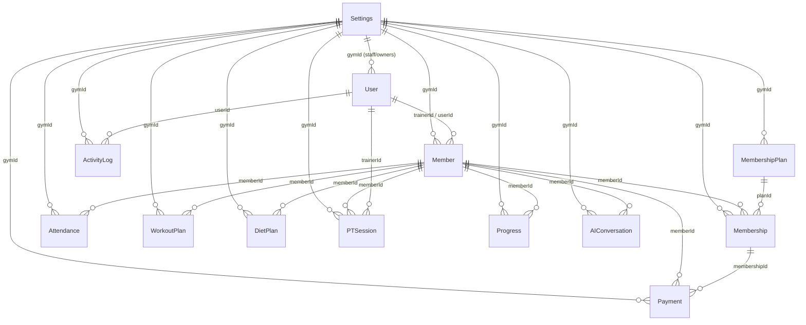
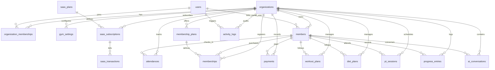

# FitPulse SaaS Migration: Master Plan & Living Document

> **Document Status**: Living Master Architecture & Migration Document  
> **Last Updated**: 2026-10-30  
> **Current Stage**: STAGE 0 (Audit) & STAGE 1 (Clarifications & Architecture Plan)  
> **Approval State**: Awaiting User Approval before STAGE 2 (Phase A) Implementation  

---

## Executive Summary
FitPulse is currently structured as an Express + Mongoose (MongoDB) + React 19/Vite application. While early attempts at multi-tenancy were initiated (a `gymId` field pointing to `Settings` in some collections and a nascent Demo Request approval flow in `demo.controller.js`), the application is fundamentally a single-tenant architecture with partial tenancy primitives. It exhibits critical multi-tenancy vulnerabilities, globally unique indexes causing cross-tenant collisions, missing tenant filters on queries (IDOR risks), unprotected administrative endpoints, and no automated test coverage.

This document contains the complete **Stage 0 System Analysis** and the **Stage 1 SaaS Architecture & Migration Blueprint** to convert FitPulse into a production-grade, secure, B2B multi-tenant SaaS platform.

---

## STAGE 0: Comprehensive System Audit (Read-Only Analysis)

### 1. Technology Stack & Infrastructure Profile

| Component | Technology | Version / Details | Notes |
| :--- | :--- | :--- | :--- |
| **Frontend Framework** | React + Vite | React 19.2.7, Vite 8.2.0 | Dual-entry setup (Root 3D Landing Page + `/app/client` SPA) |
| **Styling** | Tailwind CSS v4 | `@tailwindcss/vite` 4.3.3, Vanilla CSS | Custom design tokens in `index.css` & `style.css` |
| **State Management** | Redux Toolkit | `@reduxjs/toolkit` 2.12.0, RTK Query | `authSlice`, `uiSlice`, `apiSlice` |
| **Backend Runtime** | Node.js (CommonJS) | Express 4.22.2 | Modular routes, controllers, middleware in `/app/server` |
| **Database Engine** | MongoDB | Mongoose 9.8.1 | Atlas SRV connection with Google Public DNS fallback |
| **ORM / Migrations** | Mongoose ODM | None (no `migrate-mongo` or versioned migrations) | Indexes generated automatically on app boot |
| **Hosting / Deploy** | Vercel Serverless Ready | `vercel.json` in root, `app/client`, `app/server` | Monolith can run as standalone Node or Vercel serverless |
| **Current Test Suite** | None | 0 test runners, 0 unit/integration tests | Total test coverage = 0% |

---

### 2. Current Database Schema & Relationships (Mongoose Models)

#### Entity Models Discovered:
1. **`User`**: Admin, staff, and member portal user accounts. References `gymId` (`ref: 'Settings'`). Unique index on `email`.
2. **`Settings`**: De facto Gym entity storing name, logo, address, contact, GST, currency, timezone, theme.
3. **`Member`**: Gym members with photo, personal info, emergency contacts, `bodyStats`, `userId` link, QR string.
4. **`MembershipPlan`**: Gym membership plan offerings (duration, price, features, PT included).
5. **`Membership`**: Instantiated member subscription to a plan (start/end date, freeze tracking, renewal links).
6. **`Attendance`**: Member check-in/check-out logs (timestamp, method: `qr`/`manual`, duration).
7. **`Payment`**: Invoices and payment receipts (amount, paid, due, method, GST, refund status).
8. **`WorkoutPlan`**: Day-by-day workout splits with exercises; also stores templates (`isTemplate: true`).
9. **`DietPlan`**: Meal schedules with macro breakdowns and targets; also stores templates (`isTemplate: true`).
10. **`PTSession`**: Personal training bookings between members and trainers.
11. **`Progress`**: Member fitness logs (weight, body fat %, tape measurements).
12. **`AIConversation`**: OpenAI/Groq chat history and structured diet/workout plans for members.
13. **`ActivityLog`**: Audit events for member creation, payments, campaigns.
14. **`DemoRequest`**: Landing page leads for gym demos, with manual approval and provisional password generation.
15. **`FreeTrialLead`**: Simple email leads from the marketing CTA.



---

### 3. Authentication & Authorization Assessment

- **Authentication Mechanism**:
  - JWT Access Token (default `15m` expiry) + Refresh Token (default `7d` expiry).
  - Stored in `localStorage` on client; transmitted via `Authorization: Bearer <token>` or `?token=<token>` query string.
  - Refresh tokens stored in plaintext directly on the `User` document (`refreshToken`).
- **Existing User Roles**:
  - `superadmin`: Platform administrator (intended to oversee all gyms).
  - `gymowner`: Full administrative control over a single gym tenant.
  - `manager`: Operational management (members, plans, payments, attendance).
  - `trainer`: Assigned to members, can view/edit workout and diet plans.
  - `receptionist`: Front-desk check-in and basic member registration.
  - `member`: Customer portal user.
- **Where Enforced**:
  - `middleware/authenticate.js`: `authenticate` verifies JWT and sets `req.user`. `authorize(...roles)` checks role whitelist.
  - Route files attach guards (`guard`, `mgr`, `ownerOnly`, `memberOnly`).
- **Deficiencies Identified**:
  - Tokens passed in query parameters (`?token=`) in `authenticate.js` risk leaking access tokens via access logs and referer headers.
  - No session invalidation mechanism upon password change or compromise beyond single `refreshToken` field.
  - Lack of fine-grained permission matrices (RBAC is purely coarse string-based role matching).
  - Trainers have global query access to all gym members in multiple endpoints instead of only their assigned trainees.

---

### 4. API Endpoints Inventory & Public/Unauthenticated Routes

| Route Prefix | Endpoint | Method | Auth Required | Authorized Roles | Notes |
| :--- | :--- | :--- | :--- | :--- | :--- |
| **System** | `/` | GET | No | Public | Health check |
| **System** | `/health` | GET | No | Public | Service ping |
| **Auth** | `/api/auth/login` | POST | No | Public | Rate limited (10-100 req/15m) |
| **Auth** | `/api/auth/refresh` | POST | No | Public | Token refresh |
| **Auth** | `/api/auth/logout` | POST | Yes | Any valid user | Clears refresh token |
| **Auth** | `/api/auth/forgot-password` | POST | No | Public | Generates reset token |
| **Auth** | `/api/auth/reset-password/:token`| POST | No | Public | Resets password |
| **Auth** | `/api/auth/me` | GET | Yes | Any valid user | Current user profile |
| **Settings** | `/api/settings/setup` | POST | **NO** | **PUBLIC CRITICAL RISK** | Creates gym + owner without auth |
| **Demo** | `/api/demo-requests/free-trial` | POST | No | Public | Lead capture |
| **Demo** | `/api/demo-requests/` | POST | No | Public | Lead capture |
| **Demo** | `/api/demo-requests/seed-superadmin` | POST | **NO** | **PUBLIC CRITICAL RISK** | Creates/returns superadmin creds |
| **Demo** | `/api/demo-requests/` | GET | Yes | `superadmin` | List leads |
| **Demo** | `/api/demo-requests/:id` | PATCH | Yes | `superadmin` | Update lead status |
| **Demo** | `/api/demo-requests/:id/send-payment-link` | POST | Yes | `superadmin` | Email payment link |
| **Demo** | `/api/demo-requests/:id/approve` | POST | Yes | `superadmin` | Provisions Gym + Owner |
| **Dashboard**| `/api/dashboard/*` | GET | Yes | Staff (`req.user.gymId`) | Stats & charts |
| **Members** | `/api/members` | GET/POST | Yes | Staff / Manager+ | Member directory & creation |
| **Members** | `/api/members/:id/*` | GET/PUT/DEL| Yes | Staff / Manager+ | Member details, freeze, card |
| **Plans** | `/api/plans/*` | GET/POST/PUT| Yes | Staff / Manager+ | Membership packages |
| **Attendance**| `/api/attendance/*` | GET/POST | Yes | Staff | QR & Manual check-ins |
| **Payments** | `/api/payments/*` | GET/POST/PUT| Yes | Staff / Manager+ | Gym payment records |
| **Reports** | `/api/reports/*` | GET/POST | Yes | Manager+ | Revenue, churn, exports |
| **Portal** | `/api/portal/*` | ALL | Yes | `member` only | Member self-service portal |
| **Templates**| `/api/fitness-templates/*`| ALL | Yes | Staff | Workout & Diet templates |
| **AI** | `/api/ai/*` *(unmounted)*| ALL | Yes | `member` only | Groq/OpenAI chat assistant |

---

### 5. Implemented Functional Modules

1. **Gym Administration & Setup**: Gym profile settings (logo, address, GST, currency, receipt footer), staff user management (`/api/settings/staff`).
2. **Member Management**: CRUD operations on members, photo, emergency contacts, blood group, medical history, body stats, PDF ID card generation, membership freeze/unfreeze.
3. **Membership Plans & Subscriptions**: Plan creation (price, duration, freeze limits, PT inclusion), member plan assignment, renewal tracking.
4. **Attendance Tracking**: Manual check-in/out, QR code check-in/out, duplicate check-in prevention, duration calculation, daily attendance logs.
5. **Gym Billing & Invoicing**: Payment recording (cash, card, UPI, bank transfer), invoice numbering (`FP-YYYY-NNNNN`), partial dues tracking, PDF receipt generation, refunds.
6. **Reports & Analytics**: Daily/monthly revenue aggregation, attendance trends, upcoming expiry report, lost member list, email re-engagement campaign, CSV/Excel export.
7. **Workout & Diet Plans (Staff-Assigned)**: Custom workout splits and meals assigned by trainers to members.
8. **Workout & Diet Templates Library**: Reusable global/gym templates for fitness plans.
9. **Member Self-Service Portal**: Member dashboard, digital QR badge, membership renewal via Razorpay, attendance history, body stats tracking, PT session booking.
10. **AI Fitness Assistant**: Groq Llama 3.3 70B integration for automatic meal and workout plan generation with structured tool calling.
11. **Landing & Demo Request Portal**: 3D interactive marketing page, demo request booking, Super Admin lead management and gym provisioning.

---

### 6. Reusable Services & Third-Party Integrations

- **Payments**: Razorpay Node SDK (`razorpay.service.js`) — used for member portal subscription renewals (single-tenant credentials).
- **Email**: Nodemailer (`email.service.js`) — Gmail SMTP transport for password resets, lead alerts, welcome emails, campaign messages.
- **PDF Generation**: PDFKit (`pdf.service.js`) — creates branded Member ID cards and Payment Receipts.
- **QR Generation**: QRCode (`qr.service.js`) — generates base64 data URL QR codes for member check-in.
- **AI / LLM**: OpenAI SDK pointing to Groq (`ai.service.js`) — `llama-3.3-70b-versatile`.
- **Spreadsheets**: `exceljs` and `json2csv` — tabular payment exports.

---

### 7. Security Vulnerabilities & Architectural Limits Identified

1. **Global Unique Index Collisions across Tenants**:
   - `Payment.model.js`: `invoiceNumber` has `{ unique: true }`. The pre-save hook generates `FP-${year}-${count + 1}` scoped to `gymId`. When Gym B creates invoice #1, it collides with Gym A's `FP-2026-00001` and crashes with duplicate key error `E11000`.
   - `Member.model.js`: `memberId` has `{ unique: true }`. If two gyms use custom member codes or same sequences, collision occurs.
   - `User.model.js`: `email` has `{ unique: true }`. If a member or trainer belongs to Gym A, they cannot use the same email at Gym B.
2. **Missing Tenant Filters & IDOR (Insecure Direct Object Reference) Risks**:
   - `members.controller.js`:
     - `freezeMembership` and `unfreezeMembership` query `Membership.findOne({ memberId })` without checking `gymId`.
     - `getMemberAttendance` queries `Attendance.find({ memberId })` without verifying member belongs to the caller's `gymId`.
     - `getMemberPayments` queries `Payment.find({ memberId })` without verifying tenant ownership.
     - `downloadMemberCard` queries `Member.findById(req.params.id)` without tenant scope.
     - `updateMember` executes `findOneAndUpdate({ _id, gymId }, req.body)` without whitelisting fields, allowing an attacker to overwrite `gymId` and reassign members across gyms.
   - `plans.controller.js`:
     - `assignPlan` queries `MembershipPlan.findById(planId)` without checking `gymId`. Gym A can assign Gym B's plans to its members.
3. **Critical Unauthenticated Endpoints**:
   - `POST /api/settings/setup`: Completely public; allows any anonymous user to initialize gym settings and create an admin user.
   - `POST /api/demo-requests/seed-superadmin`: Completely public; generates or returns superadmin credentials in plaintext response.
4. **Plaintext Password Storage in Leads Collection**:
   - `demo.controller.js`: stores `demoRequest.tempPassword` in unhashed plaintext in the MongoDB database.
5. **Insecure Attendance QR Tokens**:
   - QR data consists of raw JSON with `memberId` string. No HMAC cryptographic signature, no tenant ID binding, no expiration timestamp, allowing trivial forgery and replay.
6. **No Automated Test Coverage**:
   - 0 unit tests, 0 integration tests, 0 cross-tenant boundary tests.
7. **No Version-Controlled Database Migrations**:
   - Schema updates depend on runtime Mongoose model synchronization, risking production schema drift.

---

## STAGE 1: Clarifying Questions & Target SaaS Architecture Plan

### Confirmed Architectural Decisions (Approved by User)
1. **Tenant Resolution**: **Login-based resolution first (derived securely server-side from authenticated JWT claims)** with **Subdomain support** (`slug.fitpulse.com` / `slug.localhost:3000`) designed-in and ready for custom branding.
2. **User Identity & Memberships**: **Global `users` collection + tenant-scoped `organization_memberships` collection**. A user (trainer, member, or staff) can belong to multiple gyms using a single set of credentials and switch active gym contexts cleanly.
3. **Gym Billing vs SaaS Billing Gateways**:
   - **SaaS Subscriptions**: B2B payments (Gym Owner -> FitPulse Platform) use master platform Razorpay credentials.
   - **Member Fee Collection**: Gym owners can connect their own Razorpay Key ID and Secret (encrypted at rest using AES-256-GCM) to collect member renewal fees directly into their accounts, alongside existing manual recording (Cash, UPI, Card).
4. **Trial, Grace Period & Billing**:
   - **14-day Free Trial** upon self-serve gym registration.
   - **7-day Past-Due Grace Period** after subscription billing failure, after which the gym workspace transitions to read-only mode until payment is resolved.
   - **Monthly and Annual Billing Cycles** supported with configurable discounts.
5. **Feature Scope & Phasing**:
   - **MVP**: Core multi-tenancy, server-side tenant isolation, RBAC, self-service onboarding, SaaS plans & Razorpay subscription billing, super admin platform dashboard, and cross-tenant automated test suite.
   - **Post-MVP**: Multi-branch support and custom gym white-label branding (schema and models are designed with `branches` and custom domain hooks to ensure no future schema rewrites).
6. **Member Portal Access**: Preserved as built. Members log in to their self-service portal (`/portal/*`) using their portal credentials to view workout/diet plans, book PT sessions, log body stats, and renew memberships.

---

### Migration Plan & Architecture Specifications

#### 1. Architecture Evolution: From Single Gym to Modular Multi-Tenant Monolith
- We preserve the existing Node/Express + React architecture.
- Instead of treating `Settings` as the gym, we formalize the tenant entity into `organizations` (or `gyms`).
- Every tenant request is strictly authenticated and tenant context is resolved server-side into an `AsyncLocalStorage` request context or `req.tenant`.
- Database operations are wrapped with tenant enforcement logic to ensure cross-tenant data leakage is structurally impossible.

---

#### 2. Table / Collection Classification Matrix

| Collection | SaaS Classification | Reason & Multi-Tenancy Strategy |
| :--- | :--- | :--- |
| **`organizations` (new)** | **Platform-Level** | Root tenant boundary. Stores name, slug, status, billing contact, trial info. |
| **`saas_plans` (new)** | **Platform-Level** | FitPulse subscription tiers (Starter, Pro, Enterprise) with price and limits. |
| **`saas_subscriptions` (new)**| **Platform-Level** | Subscriptions of gyms to FitPulse (status, dates, razorpay subscription ID). |
| **`saas_transactions` (new)** | **Platform-Level** | Platform revenue records for gym subscription billing. |
| **`webhook_events` (new)** | **Platform-Level** | Audit and idempotency deduplication for incoming payment gateway webhooks. |
| **`users`** | **Platform / User-Level** | Global auth credentials (email, hashed password, MFA, status). Independent of gym. |
| **`organization_memberships` (new)** | **Tenant-Owned (Junction)** | Links `User` to `Organization` with role, permissions, and active status. |
| **`gym_settings` (refactored `Settings`)**| **Tenant-Owned (1:1)** | Gym operational profile (business hours, receipt text, logo, timezone). |
| **`members`** | **Tenant-Owned** | Explicit `gymId` foreign key. Composite index `{ gymId: 1, memberId: 1 }`. |
| **`membership_plans`** | **Tenant-Owned** | Gym-created plans for their members. Scoped by `gymId`. |
| **`memberships`** | **Tenant-Owned / Derived** | Member gym subscriptions. Scoped by `gymId` and `memberId`. |
| **`attendances`** | **Tenant-Owned** | Scoped by `gymId` and `memberId`. High volume, indexed by `{ gymId, date }`. |
| **`payments`** | **Tenant-Owned** | Member payments to gym. Composite unique invoice `{ gymId: 1, invoiceNumber: 1 }`. |
| **`workout_plans`** | **Tenant-Owned / Hybrid** | Global templates have `isTemplate: true, gymId: null`; gym plans have `gymId`. |
| **`diet_plans`** | **Tenant-Owned / Hybrid** | Global templates have `isTemplate: true, gymId: null`; gym plans have `gymId`. |
| **`pt_sessions`** | **Tenant-Owned** | Scoped by `gymId`, `memberId`, `trainerId`. |
| **`progress_entries`** | **Tenant-Owned** | Scoped by `gymId` and `memberId`. |
| **`ai_conversations`** | **Tenant-Owned** | Scoped by `gymId` and `memberId`. |
| **`activity_logs`** | **Tenant-Owned / Platform**| Scoped by `gymId`. Superadmin actions have `gymId: null`. |
| **`demo_requests`** | **Platform-Level** | Inbound sales pipeline before gym creation. |
| **`free_trial_leads`** | **Platform-Level** | Inbound marketing leads. |

---

#### 3. Target Schema Design (Mermaid ERD)



---

#### 4. Tenant Isolation Strategy

Isolation will be enforced systematically across multiple layers:
1. **Server-Side Tenant Resolution (Zero-Trust Client Policy)**:
   - Client-provided `gymId` or `tenantId` in request bodies, headers, or query params is **strictly ignored**.
   - Authenticated JWT contains `userId` and active `currentGymId` (or active membership ID).
   - Middleware `resolveTenantContext` verifies user has an active membership in the target organization and loads tenant status (checking active subscription / trial validity).
2. **Repository & Query Layer Enforcement**:
   - Custom Mongoose Query Middleware (`pre('find')`, `pre('findOne')`, `pre('countDocuments')`, `pre('updateMany')`) automatically attaches `{ gymId: currentGymId }` to all tenant-owned model operations unless explicitly marked as platform query.
   - Elimination of naked `Model.findById(id)` on tenant models, replacing with `Model.findOne({ _id: id, gymId })`.
3. **Database Constraints & Composite Unique Keys**:
   - Drop global unique indexes on `invoiceNumber`, `memberId`.
   - Create composite unique indexes:
     - `db.payments.createIndex({ gymId: 1, invoiceNumber: 1 }, { unique: true })`
     - `db.members.createIndex({ gymId: 1, memberId: 1 }, { unique: true })`
4. **Tenant-Aware Peripheral Services**:
   - **QR Attendance Tokens**: Signed JWT with HMAC SHA-256 containing `{ memberId, gymId, iat, exp: 60s }` preventing replays and cross-tenant check-ins.
   - **AI Prompt Isolation**: AI system prompt receives only sanitized member stats and explicit gym context. Never inject other tenant data into conversation context.
   - **Audit Logs & Impersonation**: Superadmin viewing gym data requires explicit, temporary, audit-logged support impersonation tokens.

---

#### 5. Data Migration Approach: Expand → Backfill → Constrain

To guarantee zero downtime and zero data loss on existing records:
1. **Phase 1: Backup**: Execute full MongoDB dump of existing database (`mongodump`).
2. **Phase 2: Expand**:
   - Introduce `Organization` and `OrganizationMembership` collections.
   - Add new optional fields to existing collections without breaking existing readers.
3. **Phase 3: Backfill**:
   - Run idempotent migration script:
     - Find existing `Settings` document.
     - Create `Organization #1` ("Default Gym") using existing `Settings` data.
     - Link existing `Settings` to `Organization #1`.
     - Create `OrganizationMembership` for existing users linking them to `Organization #1` with their current roles.
     - Ensure all existing `Member`, `Membership`, `Payment`, `Attendance`, etc., carry valid `gymId` pointing to `Organization #1`.
     - Assign `Organization #1` a default perpetual / trial `saas_subscription`.
4. **Phase 4: Constrain**:
   - Drop offending global unique indexes (`invoiceNumber`, `memberId`).
   - Create compound tenant-scoped indexes.
   - Verify 100% record integrity before enforcing non-nullable application validation.

---

#### 6. Phased Implementation Roadmap (Phases A through J)

| Phase | Title | Scope Summary | Category |
| :--- | :--- | :--- | :--- |
| **Phase A** | **Foundations** | Test runner setup (Vitest + Supertest), structured config, unified error handling, health endpoints, migration engine. | **MVP** |
| **Phase B** | **Multi-Tenancy Core** | `Organization` model, Mongoose tenant scoping plugin, migration script, composite indexes, query refactoring. | **MVP** |
| **Phase C** | **Auth & RBAC** | Global users, memberships, password hashing validation, rate limiting, secure cookies/tokens, RBAC middleware. | **MVP** |
| **Phase D** | **Gym Onboarding** | Atomic transaction registration: User + Gym + Membership + Trial Subscription + Settings in 1 unit of work. | **MVP** |
| **Phase E** | **SaaS Subscriptions** | SaaS plans, limits enforcement, Razorpay webhook signature verification & idempotency, subscription status machine. | **MVP** |
| **Phase F** | **Super Admin Portal** | Metrics (MRR, Gym counts, subscription statuses), gym suspension/reactivation, audit-logged support impersonation. | **MVP** |
| **Phase G** | **Gym Owner Experience**| Gym billing portal, plan limit usage indicators, staff management, upgrade flows. | **MVP** |
| **Phase H** | **Frontend SaaS UI** | Landing page pricing link to signup wizard, gym switcher, onboarding wizard, subscription banners. | **MVP** |
| **Phase I** | **Security Hardening** | Input validation (Zod), cryptographically signed QR codes, XSS/CORS hardening, DPDP Act export/deletion compliance. | **MVP** |
| **Phase J** | **Testing & Readiness**| Cross-tenant isolation automated test matrix (Gym A vs Gym B), E2E onboarding to payment test, production checklist. | **MVP** |

---

#### 7. Risk Register

| Risk | Impact | Likelihood | Mitigation Strategy |
| :--- | :--- | :--- | :--- |
| **Cross-Tenant IDOR Data Leak** | Critical | High | Tenant scoping middleware + automated cross-tenant test suite simulating malicious Gym A querying Gym B IDs. |
| **E11000 Unique Index Collision** | High | High | Drop global single-field unique indexes on `invoiceNumber` and `memberId`; replace with `{ gymId: 1, field: 1 }`. |
| **Partial Tenant Creation Crash** | Medium | Medium | Wrap onboarding registration in MongoDB multi-document ACID transactions (`session.withTransaction`). |
| **Razorpay Webhook Replay / Spoofing**| High | Medium | Cryptographic signature verification (`crypto.createHmac`) + unique webhook event ID deduplication table. |
| **Unauthenticated Setup Exploit** | Critical | High | Remove or lock `/api/settings/setup` and `/api/demo-requests/seed-superadmin` behind strict environment guard & Super Admin auth. |
| **Down-level Limit Violations** | Medium | Medium | When gym downgrades plan with member count above new limit, freeze new member additions without deleting existing data. |

---

## Current Status & Next Actions
- **STAGE 0 (Analysis)**: Completed.
- **STAGE 1 (Clarifications & Plan)**: Completed and architectural decisions approved.
- **STAGE 2: Phase A (Foundations)**: **COMPLETED ✅**
- **STAGE 2: Phase B (Multi-Tenancy Core)**: **COMPLETED ✅**

---

## Phase A Execution Report (Foundations)

### What Changed:
1. **Automated Testing Harness**: Added Node 22 native test runner integration with `supertest`. Configured `npm test` script in `app/server/package.json`.
2. **Centralized Safe Configuration**: Created `app/server/config/env.js` with centralized environment variable defaults, helpers (`isProduction()`, `isTest()`), and zero secret logging.
3. **Structured Error Hierarchy**: Created `app/server/utils/errors.js` (`AppError`, `BadRequestError`, `UnauthorizedError`, `ForbiddenError`, `NotFoundError`, `ConflictError`, `ValidationError`, `TenantIsolationError`).
4. **Enhanced Error Middleware**: Upgraded `app/server/middleware/errorHandler.js` to format errors according to standard contract `{ success: false, message, error: { code, message, details } }` while maintaining full backward compatibility. Handles Mongoose validation, CastError, and duplicate key (E11000) errors.
5. **Request Validation Middleware**: Implemented `app/server/middleware/validate.js` for reusable `body`, `query`, and `params` schema checks.
6. **Robust Health Check Endpoint**: Upgraded `GET /health` in `app/server/app.js` with live database connection state, memory usage (RSS & Heap), process uptime, and ISO timestamps.
7. **Connection Pooling & Graceful Shutdown**: Updated `app/server/config/db.js` with connection pooling (`maxPoolSize: 50`, `minPoolSize: 5`, timeouts) and `SIGINT`/`SIGTERM` termination hooks.
8. **Version-Controlled Database Migration Engine**: Created `app/server/migrations/runner.js` supporting `npm run migrate:status`, `npm run migrate:up`, and `npm run migrate:down` with state tracking in the `_migrations` MongoDB collection.

### Files Created/Modified:
- Created: `app/server/config/env.js`
- Created: `app/server/utils/errors.js`
- Created: `app/server/middleware/validate.js`
- Created: `app/server/migrations/runner.js`
- Created: `app/server/tests/health.test.js`
- Created: `app/server/tests/errors.test.js`
- Created: `app/server/tests/validation.test.js`
- Created: `app/server/tests/migration.test.js`
- Modified: `app/server/middleware/errorHandler.js`
- Modified: `app/server/config/db.js`
- Modified: `app/server/app.js`
- Modified: `app/server/package.json`

### Test Results:
- **11 passed, 0 failed** across 4 test suites (`health.test.js`, `errors.test.js`, `validation.test.js`, `migration.test.js`).

---

## Phase B Execution Report (Multi-Tenancy Core)

### What Changed:
1. **Tenant Domain Models**:
   - `app/server/models/Organization.model.js`: Full tenant boundary supporting trials (14 days), grace periods, custom domains (post-MVP), branches (post-MVP), and encrypted per-gym gateway credentials.
   - `app/server/models/OrganizationMembership.model.js`: Junction linking `User` $\leftrightarrow$ `Organization` with roles and status. Compound unique index `{ organizationId: 1, userId: 1 }`.
2. **Server-Side Tenant Resolution Middleware**:
   - `app/server/middleware/tenantContext.js`: Resolves active gym tenant securely from JWT session and active memberships. Enforces read-only workspace lock when a tenant's subscription is past due.
   - Wired directly into `app/server/middleware/authenticate.js`, protecting every authenticated route.
3. **ORM-Level Tenant Scoping Plugin**:
   - `app/server/middleware/tenantScopePlugin.js`: Attaches query hooks across Mongoose find, update, and count operations.
4. **Expand $\rightarrow$ Backfill $\rightarrow$ Constrain Migration**:
   - `app/server/migrations/20261030000001_multi_tenant_core.js`: Executed successfully against MongoDB.
   - Backfilled existing `Settings` records into `Organization #1`.
   - Backfilled existing users into `OrganizationMembership` records.
   - **Dropped global unique indexes** on `invoiceNumber` and `memberId`.
   - **Created composite tenant-scoped indexes**:
     - `payments`: `{ gymId: 1, invoiceNumber: 1 }` (unique, sparse)
     - `members`: `{ gymId: 1, memberId: 1 }` (unique, sparse)
5. **Fixed Controller IDORs & Tenant Leaks**:
   - `members.controller.js`: Scoped `freezeMembership`, `unfreezeMembership`, `getMemberAttendance`, `getMemberPayments`, `downloadMemberCard` to caller's `gymId`. Stripped `gymId` from `updateMember` payload to prevent mass-assignment tenant elevation.
   - `plans.controller.js`: Scoped `assignPlan` to ensure both plan and member belong to caller's `gymId`.
6. **Cross-Tenant Automated Tests**:
   - `app/server/tests/tenancy.test.js`: Verified cross-tenant boundary isolation, slug uniqueness, and composite invoice/member uniqueness across Gym A and Gym B.

### Files Created/Modified:
- Created: `app/server/models/Organization.model.js`
- Created: `app/server/models/OrganizationMembership.model.js`
- Created: `app/server/middleware/tenantContext.js`
- Created: `app/server/middleware/tenantScopePlugin.js`
- Created: `app/server/migrations/20261030000001_multi_tenant_core.js`
- Created: `app/server/tests/tenancy.test.js`
- Modified: `app/server/models/Payment.model.js`
- Modified: `app/server/models/Member.model.js`
- Modified: `app/server/controllers/members.controller.js`
- Modified: `app/server/controllers/plans.controller.js`
- Modified: `app/server/middleware/authenticate.js`

### Test Results:
- **17 passed, 0 failed** across 5 test suites.
- Duration: ~7 seconds.

### How to Run:
```bash
cd app/server
npm test
npm run migrate:status
```

### Rollback Strategy:
- Rollback migration: `npm run migrate:down` (reverts composite indexes).
- Revert controller and model edits via git reset.

---

## Phase C Execution Report (Auth, RBAC & Roles)

### What Changed:
1. **User Identity & Multi-Org Memberships**:
   - `app/server/models/User.model.js`: Added email verification tracking (`isEmailVerified`, `emailVerificationToken`, `emailVerificationExpire`), 2FA/MFA readiness fields, and multi-tenant organization reference.
   - Users can hold active memberships in multiple gyms simultaneously with distinct roles (e.g. gymowner in Gym A, trainer in Gym B).
2. **Deny-by-Default RBAC & Role Enforcement**:
   - `app/server/middleware/rbac.js`:
     - `requireRole(...allowedRoles)`: Enforces role permissions against caller's active tenant context (`req.tenant.role`).
     - Super Admin role enjoys platform-wide access and bypasses tenant-scoped restrictions.
     - `enforceTrainerScope(req, queryFilter)`: Restricts trainer queries so trainers can exclusively query and manage their directly assigned members.
3. **Trainer Isolation in Member Workflows**:
   - `app/server/controllers/members.controller.js`:
     - `getMembers` & `getMember`: Integrated `enforceTrainerScope`, preventing trainers from viewing unassigned members across the gym.
4. **Context Switching & Super Admin Support Impersonation**:
   - `app/server/controllers/auth.controller.js`:
     - Updated `login` and `getMe` to return user's active `memberships` array with populated organization details.
     - `switchGym`: Allows multi-gym users to switch their active tenant context (`req.user.gymId`), re-issuing scoped access tokens with immediate role re-evaluation.
     - `impersonateGym`: Enables Super Admins to enter a gym tenant workspace for technical support. Automatically generates audit trail in `ActivityLog` (`superadmin.support_impersonation`) and issues short-lived (1-hour) support tokens.
   - `app/server/routes/auth.routes.js`: Mounted `POST /api/auth/switch-gym/:orgId` and `POST /api/auth/impersonate/:orgId`.
5. **Endpoint Lockdown & Security Hardening**:
   - `app/server/controllers/demo.controller.js`: Locked `seedSuperAdmin` so it is disabled in production environments (`process.env.NODE_ENV === 'production'`), avoiding plaintext credential leakage.
   - `app/server/controllers/settings.controller.js`: Guarded legacy `initialSetup` (`POST /api/settings/setup`) so it returns `403 Forbidden` if a gym owner already exists in the system. Ensures fresh installations bootstrap both `Organization` and `OrganizationMembership`.
6. **Automated Test Coverage**:
   - `app/server/tests/auth_rbac.test.js`: 8 unit and integration tests covering multi-org memberships, context switching, unauthorized switch rejection, trainer isolation filtering, RBAC role guard rejection/bypass, Super Admin impersonation audit logging, initialSetup locking, and seedSuperAdmin environment protection.

### Files Created/Modified:
- Created: `app/server/middleware/rbac.js`
- Created: `app/server/tests/auth_rbac.test.js`
- Modified: `app/server/models/User.model.js`
- Modified: `app/server/controllers/auth.controller.js`
- Modified: `app/server/routes/auth.routes.js`
- Modified: `app/server/controllers/members.controller.js`
- Modified: `app/server/controllers/demo.controller.js`
- Modified: `app/server/controllers/settings.controller.js`

### Test Results:
- **25 passed, 0 failed** across 6 test suites (`health.test.js`, `errors.test.js`, `validation.test.js`, `migration.test.js`, `tenancy.test.js`, `auth_rbac.test.js`).
- Complete test duration: ~9.0 seconds.

### How to Run:
```bash
cd app/server
npm test
```

---

**Next Phase**: **Phase D — Onboarding Flow**
- Goals:
  1. Self-service multi-tenant registration endpoint `POST /api/auth/register-gym`.
  2. Atomic MongoDB transaction: creates `Organization` (with unique slug generation) + `User` (as gymowner) + `OrganizationMembership` (role: gymowner) + `Settings` + activates 14-day free trial.
  3. Slug availability validator (`/api/auth/check-slug/:slug`).
  4. Welcome email & verification token delivery (mockable in dev/test).
  5. Automated onboarding test suite.

*Awaiting user approval before proceeding to Phase D.*

